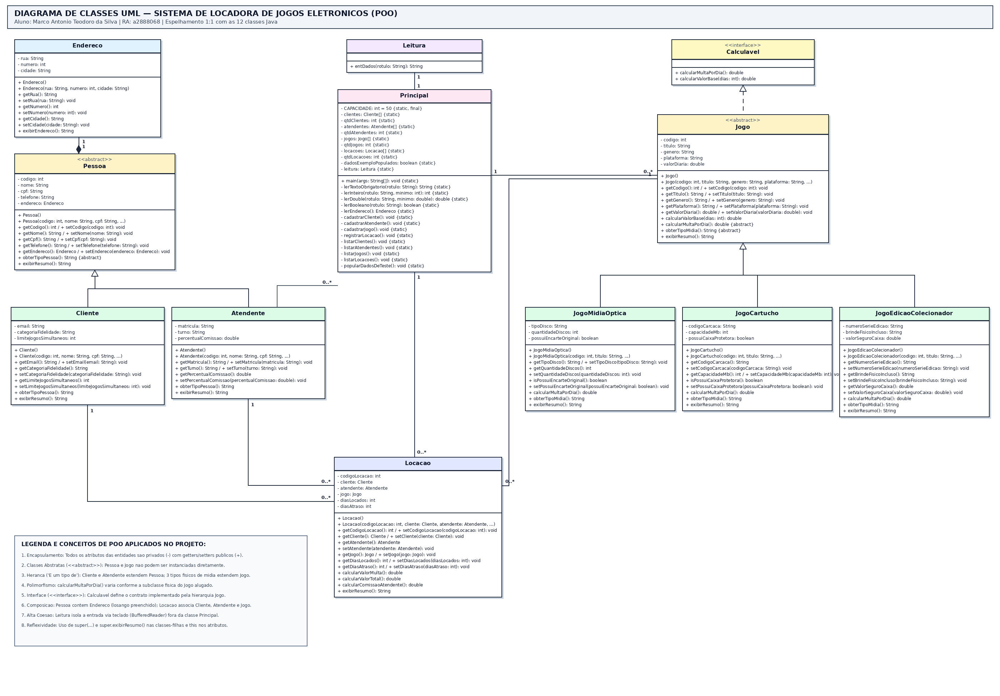

# Sistema de Locadora de Jogos Eletrônicos — Projeto de POO (UTFPR)

- **Aluno:** Marco Antonio Teodoro da Silva
- **RA:** `a2888068`
- **Disciplina:** Programação Orientada a Objetos (Prof. José Antônio)

---

## Descrição do Projeto

O projeto gerencia uma **Locadora Física de Jogos Eletrônicos**, permitindo a coleta via teclado (`Leitura`) e o armazenamento em **arrays** de **Clientes** (`Cliente[]`), **Atendentes** (`Atendente[]`), **Jogos Físicos** (`Jogo[]`) e **Locações** (`Locacao[]`), identificando o atendente responsável por cada locação e calculando polimorficamente o valor total e a multa por dias de atraso conforme o tipo físico de jogo (`JogoMidiaOptica`, `JogoCartucho` ou `JogoEdicaoColecionador`).

---

## Conceitos de POO e Regras Aplicadas

1. **Encapsulamento**: Todos os atributos das classes de entidade são `private` (`-`) e acessados por métodos `getters` e `setters` `public` (`+`).
2. **Papéis e Responsabilidades**: Toda impressão de dados em tela ocorre exclusivamente na classe de controle (`Principal`), utilizando os métodos `getters` (nenhuma impressão ou montagem de resumo ocorre nas classes entidades).
3. **Classes Abstratas (`abstract class`)**:
   - `Jogo` (superclasse abstrata de `JogoMidiaOptica`, `JogoCartucho` e `JogoEdicaoColecionador`).
   - `Pessoa` (superclasse abstrata de `Cliente` e `Atendente`).
4. **Herança ("É um tipo de...") com 3 classes-filhas em `Jogo` e 3 atributos próprios em cada filha**:
   - `JogoMidiaOptica`, `JogoCartucho` e `JogoEdicaoColecionador` estendem `Jogo`.
   - `Cliente` e `Atendente` estendem `Pessoa`.
5. **Polimorfismo (`// Sobrescrita` + `@Override`)**:
   - Os métodos `calcularMultaPorDia()` e `obterTipoMidia()` são sobrescritos especificamente para cada mídia física, e `obterTipoPessoa()` é sobrescrito em `Cliente` e `Atendente`.
6. **Interface (`interface`)**:
   - `Calculavel` define o contrato `calcularMultaPorDia()` e `calcularValorBase(int dias)`.
7. **Composição, Associação e Reflexividade (`//Reflexividade`)**:
   - `Pessoa` contém um objeto `Endereco` (composição) manipulado por chamadas encadeadas (`getEndereco().setRua(...) //Reflexividade`, `getEndereco().getRua() //Reflexividade`).
   - `Locacao` associa `Cliente`, `Atendente` e `Jogo`, acessados via reflexividade (`getCliente().getNome() //Reflexividade`, `getJogo().calcularMultaPorDia() //Reflexividade`, etc.).
8. **Alta Coesão e Entrada via Teclado sem Validação Bloqueante ou Senhas**:
   - `Leitura` isola `entDados(String rotulo)` fora da classe `Principal`, exibindo o formato esperado diretamente nos rótulos de tela e sem validação de documentos (como CPF) ou senhas de acesso.

---

## Diagrama de Classes UML



---

## Como Compilar e Executar

```bash
javac *.java
java Principal
```
