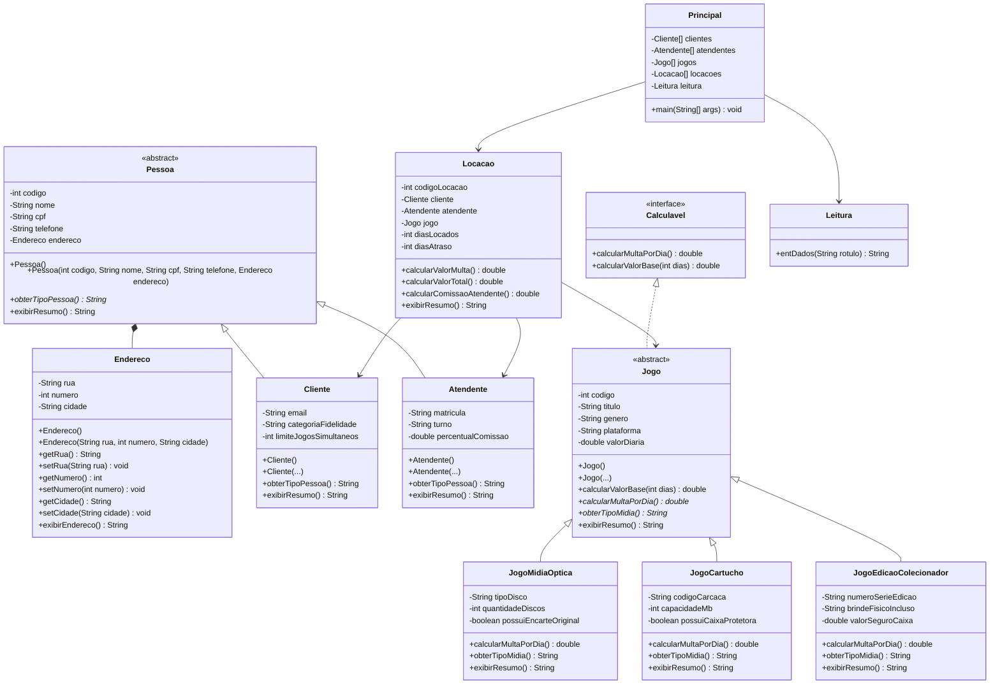

# Sistema de Locadora de Jogos Eletrônicos — Projeto Final de POO (UTFPR)

- **Aluno:** Marco Antonio Teodoro da Silva
- **RA:** `a2888068`
- **Disciplina:** Programação Orientada a Objetos (Prof. José Antônio)

---

## Descrição do Projeto

O projeto gerencia uma **Locadora Física de Jogos Eletrônicos**, permitindo a coleta via teclado (`Leitura`) e o armazenamento em **arrays** de **Clientes** (`Cliente[]`), **Atendentes** (`Atendente[]`), **Jogos Físicos** (`Jogo[]`) e **Locações** (`Locacao[]`), identificando o atendente responsável por cada locação e calculando polimorficamente o valor total e a multa por dias de atraso conforme o tipo físico de jogo (`JogoMidiaOptica`, `JogoCartucho` ou `JogoEdicaoColecionador`).

---

## Conceitos de POO Aplicados (100% Alinhados com as Regras da Disciplina)

1. **Encapsulamento**: Todos os atributos das classes de entidade são `private` (`-`) e acessados por métodos `getters` e `setters` `public` (`+`).
2. **Classes Abstratas (`abstract class`)**:
   - `Pessoa` (superclasse abstrata de `Cliente` e `Atendente`)
   - `Jogo` (superclasse abstrata de `JogoMidiaOptica`, `JogoCartucho` e `JogoEdicaoColecionador`)
3. **Herança ("É um tipo de...") com 2+ classes-filhas e 3 atributos próprios em cada filha**:
   - `Cliente` e `Atendente` estendem `Pessoa`.
   - `JogoMidiaOptica`, `JogoCartucho` e `JogoEdicaoColecionador` estendem `Jogo`.
4. **Polimorfismo (Sobrescrita `@Override` e Sobrecarga de Construtores)**:
   - O método `calcularMultaPorDia()` calcula a multa de atraso de forma específica para cada tipo físico de mídia.
5. **Interface (`interface`)**:
   - `Calculavel` define o contrato `calcularMultaPorDia()` e `calcularValorBase(int dias)`.
6. **Composição e Associação**:
   - `Pessoa` possui um objeto `Endereco` (composição).
   - `Locacao` associa `Cliente`, `Atendente` (responsável pela locação) e `Jogo`.
7. **Alta Coesão e Entrada via Teclado**:
   - A classe `Leitura` isola o método `entDados(String rotulo)` fora da classe `Principal`.
8. **Reflexividade**:
   - Uso de `this.` para referenciar atributos da própria instância e `super(...)` / `super.exibirResumo()` nas classes-filhas.
9. **Única Classe com `main`**:
   - Apenas `Principal.java` possui o método `public static void main(String[] args)`, gerenciando todo o sistema e testando todas as classes.

---

## Diagrama de Classes UML




---

## Como Compilar e Executar

```bash
javac *.java
java Principal
```
